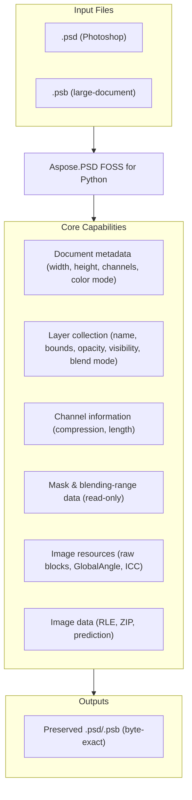

# Aspose.PSD FOSS for Python  

[](https://pypi.org/project/aspose-psd-foss/)  
[](https://pypi.org/project/aspose-psd-foss/)  
[](License/LICENSE.txt)  
[](https://github.com/aspose-psd-foss/Aspose.PSD-FOSS-for-Python/graphs/contributors)  

[](https://products.aspose.org/psd/python/)  

Aspose.PSD FOSS for Python is a free, open-source, pure-Python library for reading, inspecting and saving Adobe Photoshop `.psd`/`.psb` files without rendering. It runs on Python 3.7+ and depends only on the standard library. The library supports reading of document metadata, layers, channel information, blend modes, masks, image resources and image-data structures (RLE and ZIP compression).  

## Navigation  

- [At a Glance](#at-a-glance)  
- [Key Capabilities](#key-capabilities)  
- [Installation](#installation)  
- [Dependencies](#dependencies)  
- [Quick Start](#quick-start)  
- [Additional Examples](#additional-examples)  
- [API Reference](#api-reference)  
- [Documentation & Resources](#documentation--resources)  
- [Scope and Limitations](#scope-and-limitations)  
- [Development and Testing](#development-and-testing)  
- [License](#license)  

## At a Glance  



## Key Capabilities  

- **Document inspection** – `PsdImage` exposes `width`, `height`, `channels`, `bits_per_channel`, `color_mode`, `version`, `is_psb`, `layer_count`, `resource_count`, `compression`, `image_data_kind`, etc.  
- **Layer model** – `Layer` provides `name`, `bounds`, `top/left/bottom/right`, `width`, `height`, `opacity`, `is_visible`, `clipping`, `blend_mode_key`, `channels_count`, `channel_information`. Mutations (name, visibility, opacity, blend mode, bounds) are tracked and saved preserving raw bytes when possible.  
- **Blend modes** – `BlendMode` enum and `LayerBlendModeMapper` map between 4-character PSD keys and enum values.  
- **Channel information** – `ChannelInformation` represents per-channel compression, length and identifier; read-only, raises `NotSupportedException` on write.  
- **Mask & blending ranges** – `LayerMaskDataShort`, `LayerBlendingRangesData` expose raw length and basic properties; mutations are not supported.  
- **Image resources** – `ImageResourcesSection` parses unknown resources, preserving raw payloads; `UnknownResource` offers `resource_id`, `name`, `data`. Helper classes (`ResourceBlock`, `PreservedResourceBlock`) provide a public surface.  
- **Image data parsing** – `ImageData` parses RLE and ZIP structures without pixel decoding, exposing `structure.kind`, `row_length_field_size`, `row_byte_counts`, `compressed_payload_length`, `uses_prediction`.  
- **Byte-exact round-trip** – `PsdImage.save` preserves all unmodified sections, enabling lossless save-load cycles.  
- **Non-seekable stream support** – loading works with streams that do not support seeking.  

## Installation  

```bash
pip install aspose-psd-foss
```  

Requires Python 3.7 or later.  

## Dependencies  

### Required  

- **Python standard library** only (no external packages).  

### Native / System  

- None.  

### Development  

- `pytest` ≥ 7.0.0 – test runner.  
- `pytest-cov` ≥ 4.0.0 – coverage reporting.  

## Quick Start  

```python
from aspose_psd_foss.psdimage import PsdImage

# Load a PSD file
with PsdImage.load("example.psd") as img:
    print(f"Size: {img.width}x{img.height}")
    print(f"Layers: {len(img.layers)}")
    first = img.layers[0]
    print(f"First layer name: {first.name}")
    print(f"Blend mode: {first.blend_mode_key}")

    # Change visibility and save
    first.is_visible = not first.is_visible
    img.save("modified.psd")
```  

## Additional Examples  

### Enumerate layers and bounds  

```python
from aspose_psd_foss.psdimage import PsdImage

with PsdImage.load("sample.psd") as img:
    for idx, layer in enumerate(img.layers):
        print(f"{idx}: {layer.name} – {layer.bounds}")
```  

### Change layer blend mode  

```python
from aspose_psd_foss.psdimage import PsdImage
from aspose_psd_foss.layers.blendmode import BlendMode

with PsdImage.load("sample.psd") as img:
    img.layers[1].blend_mode_key = BlendMode.MULTIPLY
    img.save("blend_changed.psd")
```  

### Inspect image resources  

```python
from aspose_psd_foss.psdimage import PsdImage
from aspose_psd_foss.resources.imageresourceids import ImageResourceIds

with PsdImage.load("sample.psd") as img:
    for res in img.image_resources:
        if res.resource_id == ImageResourceIds.GLOBAL_ANGLE:
            print("Global angle resource found")
```  

### Verify byte-exact round-trip  

```python
with open(input_path, "rb") as f:
    input_bytes = f.read()

    input_stream = io.BytesIO(input_bytes)
    original_position = input_stream.tell()
    image = Image.load(input_stream)  # type: PsdImage

    print("Aspose.PSD Stream Sample")
    print(f"Input: {input_path}")
    print(f"Output: {output_path}")
    print(f"InputBytes: {input_byte_count}")
    print(f"OriginalStreamPosition: {original_position}")
    print(f"StreamPositionAfterLoad: {current_position}")

    output_stream = io.BytesIO()
    image.save(output_stream)
    output_bytes = output_stream.getvalue()
    with open(output_path, "wb") as f:
        f.write(output_bytes)
```  

## API Reference  

The public entry point is the `aspose_psd_foss` package.  

<details>  
<summary>Supported Public Types</summary>  

### Core  

| Class / Enum | Description |
|---|---|
| `PsdImage` | Main image class; load, inspect and save PSD/PSB files. |
| `Image` (ABC) | Abstract base for image loaders. |
| `ImageLoader` | Static loader used by `Image.load`. |
| `PsdHeader` | Parsed file header. |
| `ColorData` | Color mode data (RGB, CMYK, Indexed palette). |
| `ImageResourcesSection` | Image resources container. |
| `UnknownResource` | Raw resource block without specific semantics. |
| `LayerAndMaskSection` | Layer & mask information container. |
| `Layer` | Represents a single layer; mutable properties. |
| `LayerRawData` | Internal raw data for a layer (preserved on save). |
| `ChannelInformation` | Public view of a layer channel. |
| `BlendMode` (Enum) | Blend mode enumeration. |
| `LayerBlendModeMapper` | Maps between PSD keys and `BlendMode`. |
| `Rectangle` | Integer rectangle utility. |
| `Point` | 2-D point utility. |
| `Size` | Width/height container. |
| `ImageData` | Image data section with compression and structure. |
| `ImageDataStructure` | Structural view of image data payload. |
| `ImageDataKind` (Enum) | Kind of image data (RAW, RLE, ZIP, UNKNOWN). |
| `CompressionMethod` (Enum) | Compression methods (RAW, RLE, ZIP). |
| `PsdColorDataKind` (Enum) | Color data kinds (NONE, INDEXED_PALETTE, RGB_PAYLOAD, CMYK_PAYLOAD, RAW_PRESERVED). |
| `PsdResourceKind` (Enum) | Resource classification (UNKNOWN, GLOBAL_ANGLE, ICC_PROFILE, ICC_UNTAGGED_PROFILE). |
| `ResourceBlock` (ABC) | Base class for resource blocks. |
| `PreservedResourceBlock` | Wrapper for raw-preserved resources. |
| `BigEndianReader` | Reads big-endian primitives from a stream. |
| `BigEndianWriter` | Writes big-endian primitives to a stream. |
| `BigEndianBitConverter` | Byte-array conversion helpers. |
| `PsdLoadException` | Loading-time errors. |
| `PsdSaveException` | Saving-time errors. |
| `ArgumentNullException` | Null argument errors. |
| `NotSupportedException` | Unsupported operation errors. |
| `ImageResourceIds` | Common resource identifiers used in tests. |
| `IndexedColorPalette` | Indexed palette parser (256 entries). |
| `IndexedColorPaletteInfo` | Public view of an indexed palette. |
| `PsdVersion` (Enum) | Container version (PSD, PSB). |
| `LayerMaskInfo` | Mask presence info. |
| `LayerMaskDataShort` | Short mask data implementation. |
| `LayerBlendingRangesData` | Blending range data (read-only). |
| `LayerBlendingRangesInfo` | Blending range presence info. |
| `LayerMaskFlags` (Flag) | Mask flag bits. |
| `LayerChannelInfo` | Internal channel metadata. |
| `PsdLayerChannelInfo` | Public read-only channel info. |
| `PsdImageDocumentState` | Internal state holder for all sections. |
| `PsdImageWriter` | Writes a complete document state. |
```  

</details>  

## Documentation & Resources  

- **[Getting Started Guide](https://products.aspose.org/psd/python/)** – Overview of loading, inspection and saving.  
- **[API Reference](https://reference.aspose.org/psd/python/)** – Full browsable documentation of public types.  
- **[Knowledge Base](https://kb.aspose.org/psd/python/)** – FAQs, troubleshooting and how-to articles.  
- **[GitHub Repository](https://github.com/aspose-psd-foss/Aspose.PSD-FOSS-for-Python)** – Source code, issue tracker and contribution guide.  

## Scope and Limitations  

- **Supported formats** – Only Photoshop `.psd` (≤ 30 000 px) and `.psb` (≤ 300 000 px) containers are read. Other Photoshop-related formats (e.g., `.psd` with 16-bit or 32-bit per channel beyond supported bit depths) are not parsed.  
- **No pixel rendering** – The library provides metadata and structural access; actual pixel rasterisation is out of scope.  
- **Read-only mask and blending-range data** – Modifying mask data or blending ranges throws `NotSupportedException`.  
- **Limited color-mode support** – Indexed palette, RGB and CMYK payloads are parsed; other modes (Bitmap, Grayscale, Multichannel, Duotone, Lab) are treated as raw preserved data.  
- **Compression** – Supports RAW, RLE and ZIP (with/without prediction) image data structures; other compression schemes are not implemented.  

## Development and Testing  

```bash
# Install development dependencies and the package in editable mode
pip install -e ".[dev]"

# Run the full test suite
pytest -o python_files="*tests.py"
```  

The test suite includes unit tests for header parsing, color data, image data structures, layer handling, resource parsing, non-seekable streams and byte-exact round-trip verification.  

## License  

This project is licensed under the [MIT License](License/LICENSE.txt). The MIT License permits use, copying, modification, distribution, sublicensing and commercial use, provided the original copyright and permission notice are retained. The software is provided without warranty.
